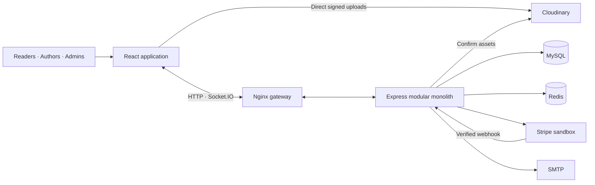

# HiBook

## Project Overview

HiBook is a text-first light novel platform where readers discover stories and support individual authors. Authors write and publish chapters, offer memberships, and communicate with eligible members; administrators manage approvals, moderation and platform pricing.

The core application is implemented and tested locally. Stripe accepts sandbox credentials only; external Stripe, SMTP and production deployment verification remain separate setup steps.

## Key Features

- **Reader:** searchable catalog, comfortable structured/Markdown reading, bookmarks, author follows, synchronized reading history, author-specific memberships, donation checkout integration and private member chat.
- **Author:** BlockNote writing studio, drafts and autosave, optional local-first illustrations, ordered post artwork, spoiler controls, two managed membership tiers, member conversations and actual audience/income records.
- **Admin:** author approvals, account suspension, independent content moderation, report review, versioned pricing/settings, audit history and operational statistics.

## Tech Stack

| Layer | Technologies |
|---|---|
| Frontend | React 19, TypeScript, Vite, React Router, Zustand, Tailwind CSS, DaisyUI |
| Authoring | BlockNote, Mantine, dnd-kit |
| Backend | Node.js 24+, Express 5, TypeScript, RS256 JWT, bcrypt |
| Data and delivery | MySQL, Redis, Socket.IO, Cloudinary |
| Integrations | Stripe sandbox SDK, Nodemailer SMTP |
| Verification and deployment | Vitest, Testing Library, Playwright, axe-core, Docker Compose, Nginx |

## Architecture



Services own business rules and transactions; repositories centralize shared queries and ownership checks. MySQL owns durable sessions, content, memberships and financial records. Redis provides bounded caches and security rate limits. Chat currently uses one backend instance, with persisted history for reconnect recovery.

## Technical Highlights

- **Session integrity:** purpose-bound JWTs, locked refresh rotation/replay detection, proof-bound account setup and transactional session revocation after password reset or suspension.
- **Transactional authoring:** versioned chapter documents preserve legacy Markdown; content, ordered assets and retry results commit together. Uploads begin on explicit save, with server confirmation and retained retry state.
- **Consistent entitlements:** author-specific tier rules apply to parent books, chapters, posts and chat. Fresh authorization precedes protected cached content and socket delivery.
- **Payment integrity:** server-priced quotes, signed raw webhooks, unique provider/event IDs, paid invoice windows and refund adjustments prevent redirects or retries from manufacturing access. External sandbox verification is still required.
- **Operational boundaries:** migration locks/checksums, awaited startup, readiness/draining, fail-closed security dependencies and SQL fallback for descriptive caches. Public image delivery and other trade-offs are documented in [security](docs/security/README.md).

## Getting Started

Install Docker with Compose v2. From the repository root:

```sh
cp .env.compose.example .env.compose
# Set two different random database passwords in .env.compose.
docker compose --env-file .env.compose up --build -d
docker compose --env-file .env.compose ps
```

On PowerShell use `Copy-Item` instead of `cp`. Open [HiBook](http://localhost:8080), [API documentation](http://localhost:8080/api-docs/) and the [local development mailbox](http://localhost:8025). MySQL/Redis stay on the internal network; volumes persist across normal shutdowns. Secrets are excluded from image builds.

Register and verify an account before granting the first administrator through the local operator CLI. See [deployment](docs/deployment/README.md) for that command, native development, signed image configuration and the production handoff. Text-only publishing works without Cloudinary or Stripe. Checkout shows unavailable controls until its server configuration is supplied; there is no live-money or author-payout implementation.

## Testing

Run `npm ci` in each package. Native checks require Node.js 24+; Windows may require `npm.cmd`.

```sh
# backend/
npm run typecheck
npm test
npm run build

# frontend/
npm run typecheck
npm run lint
npm test
npm run build
npm run test:e2e
```

Real MySQL tests require explicit QA opt-in. Headed E2E uses isolated fixtures and intentionally creates retained cloud test images; payment simulation is labeled and excluded from production images. The separate Compose journey verifies built assets, SMTP registration, author provisioning, publication, dependency recovery and persistence. Follow the [testing guide](docs/testing/README.md) before running either fixture suite; [executed results](docs/mvp/TEST_REPORT.md) distinguish local evidence from external-provider verification.

Latest local checks passed: **127 backend tests, 18 frontend tests, 14 headed browser journeys and one built Compose journey**, plus types, frontend lint and production builds. Browser checks include 33 rendered accessibility states; they do not establish complete WCAG conformance or external payment verification.

## Documentation

[Architecture](docs/architecture/README.md) · [API](docs/api/README.md) · [Database](docs/database/README.md) · [Security](docs/security/README.md) · [Deployment](docs/deployment/README.md) · [Testing](docs/testing/README.md) · [Implementation checklist](docs/mvp/MASTER_CHECKLIST.md)

Detailed engineering records live under [`docs/`](docs/README.md). The original audit is retained as historical evidence rather than presented as the current implementation state.

Merged-main verification at `fc6f022` passed the complete suite; see the [release readiness report](docs/mvp/RELEASE_READINESS.md) for the feature matrix, security/payment evidence, Git history and remaining deployment actions.
