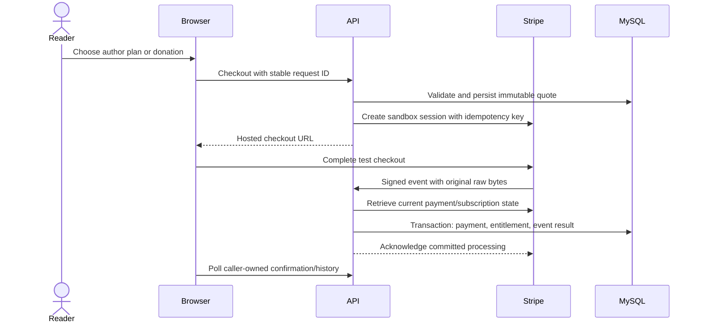

# Sandbox billing architecture

5 November 2026. The application uses one Stripe adapter behind a small `PaymentProvider` contract. A second provider can implement that contract without changing entitlement rules. No PayPal integration or live payment processing is claimed.

## Trust boundaries

The browser supplies an author, managed tier or donation amount and stable UUID request key. The service validates availability and fixed platform pricing, snapshots the currency, policy version and revenue share, and commits an opaque checkout intent before calling Stripe. A user lock serializes competing purchases; quotas allow ten new intents per minute and 100 per day. Request keys bind to a payload hash. Provider checkout uses a deterministic idempotency key; retrying an ambiguous response reuses the same intent. Intents expire after an hour. This is not an offline checkout recovery system.

Only server configuration selects the frontend return URL. Stripe Checkout hosts the card form. The adapter accepts test keys only, pins SDK/API version `2026-10-28.endive`, requests card payments and validates the returned Stripe checkout URL. HiBook never receives card data. Missing credentials expose unavailable controls and return 503 on billing operations.

## Financial and membership consistency

The raw webhook router precedes JSON parsing. The official SDK checks the signature and five-minute timestamp tolerance; live events are rejected. Event IDs are durable and unique. Payment/invoice IDs and payment-intent IDs are independently unique, so a second event ID cannot double-count the same payment. Acknowledgment follows transaction commit. Unknown/unrecorded refund payments return a retryable 503 rather than losing the event.

Subscription access comes from `invoice.paid`, not checkout completion or the return URL. The adapter retrieves the invoice and current subscription, requires one fixed-price monthly line and one paid payment, validates currency/amount against the original quote, and persists the absolute paid period. Unsupported discounts, prorations, multiple payments and manual invoices require reconciliation. New platform policy prices do not silently change existing recurring subscription prices or their share snapshot.

Current subscription state is fetched while holding the intent lock. This prevents concurrent older notifications from overwriting a newer provider snapshot. It deliberately holds a database transaction across one bounded provider call: acceptable for this low-volume modular monolith, with a ten-second request timeout and one SDK network retry. Higher throughput may justify a durable worker later; no event bus/outbox is needed for the present synchronous contract.

Cancel-at-period-end disables renewal and preserves the paid period. Past-due/unpaid/paused/incomplete subscriptions do not grant access. Canceled subscriptions cannot be reactivated by a late paid notification because current provider state is reread. A renewal uses its provider period end, never “add a month per event.”

Refunds use the retrieved charge's cumulative refunded amount. Only positive increases adjust totals; append-only adjustment rows record each applied delta and provider event. Full refund removes that payment's paid-period evidence. An older refunded invoice cannot revoke a later unrefunded period. The shared entitlement SQL additionally requires a paid, unrefunded invoice covering the database's current time for a billing-managed membership. Thus a future renewal cannot bridge a refunded current period, and access starts when that future paid period actually begins without a timer job. Untracked legacy/manual memberships retain their original period rules. Partial refunds retain access. Donation payments create ledger rows and author income, never memberships. The platform cut is integer floor of net cents × snapshotted basis points / 10,000; the author receives the remainder. Original gross, cumulative refunds and current split remain reconcilable. Fees, tax collection, connected accounts, payouts and disputes are not implemented; this is sandbox billing, not a live marketplace settlement system.

## Test boundary and limits

`createPaymentService(provider)` and `createHttpApp(provider)` accept explicit dependencies. The production composition only creates the Stripe adapter. The local QA server separately mounts a labelled fixture checkout and injects its provider; those routes and fixture files are outside `src`/`dist`, require the isolated QA database, and bind loopback. There is no deployed HTTP switch for enabling test billing.

Tests use real SDK-generated webhook signatures and real MySQL transactions. Adapter tests intercept its HTTP transport to verify current API request/response fields without calling Stripe. Browser fixtures drive the actual application, raw webhook verification, persistence, access checks and histories. They prove application integration, **not live Stripe sandbox compatibility**. The external sandbox procedure remains required; see [setup](../mvp/PAYMENT_SETUP.md).

Provider events for charges outside this application need operator review in a shared Stripe account. Use a dedicated sandbox, monitor delivery failures, and compare the read-only admin reconciliation result with Stripe invoices/charges before taking manual action. No automatic refund, charge, payout or provider deletion is performed.

Primary references: [Stripe webhooks](https://docs.stripe.com/webhooks), [subscription lifecycle events](https://docs.stripe.com/billing/subscriptions/webhooks), [Checkout creation](https://docs.stripe.com/api/checkout/sessions/create), [invoice object](https://docs.stripe.com/api/invoices/object), [refund object](https://docs.stripe.com/api/refunds/object). Installed SDK declarations provide the pinned API fields.
