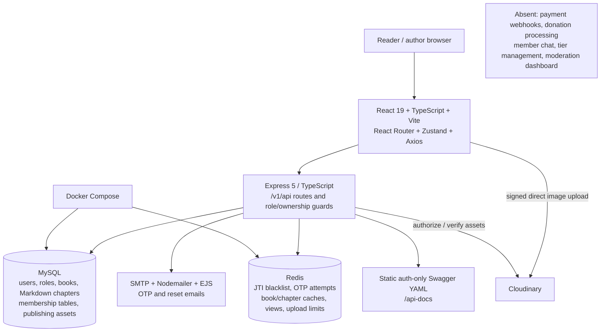

# MVP readiness

**MVP NOT READY** for the full scope in the attached task. A limited seeded-author free-reading demonstration works. It is not a safe public launch and is not a paid-membership MVP.

## Architecture and actual inventory

Evidence: `frontend/package.json`, `frontend/src/App.tsx`, `frontend/src/lib/axios.ts`, `backend/package.json`, `backend/src/routes/index.ts`, `backend/src/app.ts`, `backend/src/migrations/`, `backend/src/utils/cache.ts`, `backend/docker/docker-compose.yml`.

Backend architecture is conventional route → controller → service → repository over MySQL. The publishing service intentionally performs related SQL in a transaction. Preserve this stack; neither NestJS nor new microservices is required to complete the missing journeys. MongoDB-named configuration/helpers are not evidence of an active MongoDB product module: runtime database imports and installed drivers point to MySQL/Redis.

Payments and chat are absent from route registration and package dependencies. `memberships.provider` has `STRIPE/PAYPAL/MANUAL` enum values, but those strings are schema options, not integrated providers. There are no payment/donation/message tables or webhook handlers in the migrations/routes inventory. No Socket.IO/WebSocket server is registered. Kafka is unnecessary and out of scope.

## Text-first product fit

| Question | Finding and evidence |
|---|---|
| Text-only chapters without uploads? | **Yes, verified.** `TEXT_E2E` in [evidence](EVIDENCE.json): 27,166 bytes, exact draft reopen/edit preservation, zero image rows and zero cloud requests. |
| Long-form writing interface? | **PARTIAL.** `PublicationEditor.tsx` offers an eight-row raw textarea inside a closed `details` element for a new chapter, after the full image organizer. It labels text optional. No formatting toolbar, preview, word counter or WYSIWYG/block editor exists. |
| Markdown preserved? | Exact `contentMd` source survives draft, reopen, editing and publication in the probe. Reader uses `react-markdown`; headings and emphasis create semantic HTML. HTML/script and JavaScript-link probes did not execute. |
| Reading typography? | **PARTIAL.** `ChapterReadingPage.tsx` wraps Markdown in a plain `w-full` div. `TEXT_E2E` measured heading 16px/weight 400, body 16px/line-height 24px, paragraph bottom margin 0px. Tailwind's reset is not countered by prose styling. Long text fits a 390px viewport, but readable paragraph/heading rhythm, font-size controls and reading preferences are absent. |
| Dialogue and line breaks? | Paragraphs and Markdown hard-break syntax were preserved in source. Plain single newlines follow Markdown soft-break behavior; no special novel dialogue editor is provided. Do not mistake source preservation for polished visual layout. |
| Very large chapters? | `LONG_TEXT_LIMIT`: a 112,640-byte content string is rejected with HTTP 413 by the default `express.json()` limit in `backend/src/app.ts`, despite `chapters.content_md` being LONGTEXT. Define and expose a deliberate text limit. |
| Optional inline illustrations? | New `chapter_images` have page order only, no position within text. Reader renders all these images **before** Markdown. Legacy Markdown can place image URLs inline, but there is no nontechnical inline-upload insertion UI. Supporting media is not integrated into the writing flow. |
| Fan-art separate from text? | Yes structurally: `fan_arts` references chapters and stores URLs separately; new confirmed publishing media use `publishing_assets/chapter_images`; primary text remains `chapters.content_md`. No destructive conversion of text into image links occurs. Fan-art is not a routed community-post feature. |

Thus, the recent implementation did **not remove** text publishing, but its image-first author UX is misaligned with a light-novel platform. Expose writing as the primary surface and keep covers/illustrations optional. See `frontend/src/features/author/PublicationEditor.tsx`, `ImageEditor.tsx`, `frontend/src/pages/ChapterReadingPage.tsx`, and migrations `20251216_0002_books.sql`, `20260502_0001_fan_arts.sql`, `20261104_0001_publishing.sql`.

## Overall completion by dimension

| Dimension | Assessment |
|---|---|
| Backend | **PARTIAL.** Publishing/authentication foundations exist; author approval is broken, and membership mutations, financial processing, chat and content moderation are absent. |
| Frontend | **PARTIAL.** Author forms and reader routes work, but the home catalog is generated sample data, writing is secondary, and paid/admin/chat journeys have no UI. |
| End-to-end integrations | **PARTIAL.** Free text publishing/reading and direct seeded entitlement checks verified. Email registration delivery is UNVERIFIED; paid, donation and chat journeys are MISSING. |
| Security | **BROKEN for public release.** Setup proof, reset revocation and refresh races have live isolated reproductions. Chapter-level membership denial and Markdown safety checks passed their tested cases. |
| Deployment | **PARTIAL / production UNVERIFIED.** Local QA servers and builds work; Compose only provides MySQL/Redis, startup has no readiness gate, and no complete production deployment exists. |

## User journeys

| Journey | Status / first failure | Frontend | Backend / missing dependency | Evidence and required fix |
|---|---|---|---|---|
| A — New reader | **PARTIAL.** Email delivery was not exercised; browsing the home catalog is sample data rather than the persisted catalog. | `pages/SignUp/*`, `LogInPage.tsx`, `HomePage/ComicGrid.tsx`, `Header.tsx`, `BookDetailPage.tsx`, `ChapterReadingPage.tsx` | `routes/access/index.ts`, `services/access.service.ts`, `otp.service.ts`, `routes/books/index.ts` | Seeded login, live title search and free chapter reading verified. Complete a safe test-mail registration/OTP/reset journey, secure setup, and connect home lists. |
| B — Author publishing | **PARTIAL overall; text-only save/publish/read COMPLETE narrowly.** A newly approved reader fails before creating a book; an already seeded author can publish text. Comfortable formatting and inline insertion are missing. | `AuthorGuard.tsx`, `PublicationEditor.tsx`, `AuthorDashboardPage.tsx`, `ChapterReadingPage.tsx` | `application.service.ts:approve`, `publishing.service.ts`, `author.repo.ts` | `AUTHOR_APPROVAL`: role granted but authors row count 0, publishing 403. `TEXT_E2E`: exact text flow succeeds for seeded author. Provision the profile atomically; fix writing UX. |
| C — Paid reader | **PARTIAL; stops at tier selection/checkout.** | No tier-selection, checkout or membership-management route in `App.tsx` | Membership tables/repository and chapter gate exist; tier CRUD, payment provider, verified webhooks and durable events are missing | `MEMBERSHIP_BOUNDARIES` validates seeded entitlements only. It does not demonstrate purchase or activation. Build a full author-scoped sandbox payment vertical slice. |
| D — Donation | **MISSING; stops at donation selection.** | `AuthorProfilePage.tsx` has a book grid, no donation checkout | No donation/transaction/webhook model or route | Add sandbox author-specific donations and verified, idempotent recording; no real payment was attempted. |
| E — Chat | **MISSING; stops at opening a conversation.** | No chat route or client | No real-time transport, conversations, messages or membership-protected retrieval | Build authenticated persisted member-author chat and expiry enforcement after entitlements exist. |
| F — Admin | **PARTIAL; stops at dashboard/content lookup.** | No admin route in `App.tsx` | `routes/admin/authorApplications.ts` supports applications only, not book hide/unhide or metrics | Admin application list 200 and reader denial 403 verified. Add moderation UI/API with server-side role enforcement and cache invalidation. |

## MVP definition of done

| # | Required condition | Result | Evidence |
|---|---|---|---|
| 1 | Register, verify email and log in | **PARTIAL** | Login verified; OTP delivery UNVERIFIED, setup binding broken (`SETUP_WITHOUT_PROOF`). |
| 2 | Author creates a book | **PASS** for a provisioned author | Headed `TEXT_E2E`; approval-to-author onboarding separately FAILS. |
| 3 | Author publishes a TEXT chapter | **PASS** for basic Markdown | 27 KB text-only browser journey, no uploads. |
| 4 | Reader comfortably reads free text | **PARTIAL** | Rendering and mobile width pass; heading/paragraph typography is inadequate. |
| 5 | Author restricts by membership tier | **PARTIAL** | Server read gate works for manually seeded mappings; no UI/API to manage tiers/mappings. |
| 6 | Reader buys membership in sandbox | **FAIL** | No checkout/provider/webhook implementation. |
| 7 | Server verifies membership access | **PARTIAL** | Chapter boundaries pass; book-level inheritance gap, no paid activation pipeline. |
| 8 | Sandbox donation | **FAIL** | No implementation. |
| 9 | Member-author chat | **FAIL** | No implementation. |
| 10 | Admin hides/unhides content | **FAIL** | No moderation API/UI. Author can hide their own book; that is not admin moderation. |
| 11 | Basic Redis integrated | **PASS** for basic capability | Revocation, cache boundary and OTP counter code; logout denial observed. Wider reliability/analytics remain partial. |
| 12 | Run from documented environment | **PARTIAL** | QA/local builds run, Compose validates; setup docs/config/production readiness incomplete. |
| 13 | Critical auth/payment tests | **PARTIAL** | Publishing tests pass; audit probes demonstrate auth failures, payment tests impossible before implementation. |

These results do not meet the requested full MVP definition. The next phase should address authentication/session safety and author provisioning, then deliver the text-first free-reading journey before building paid memberships.
